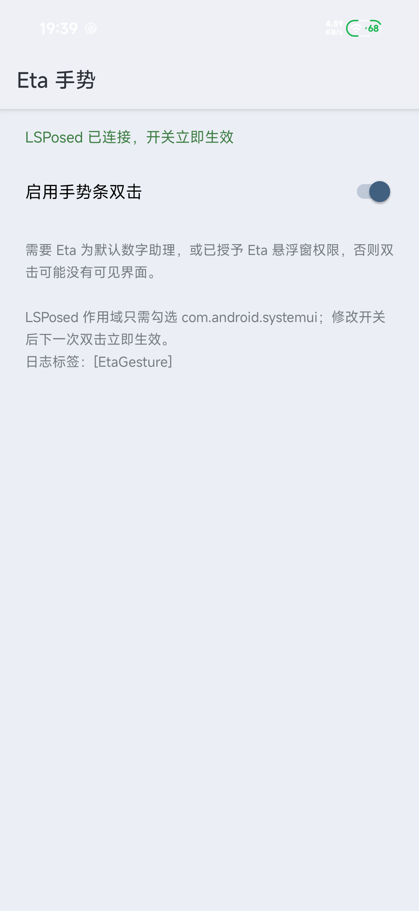
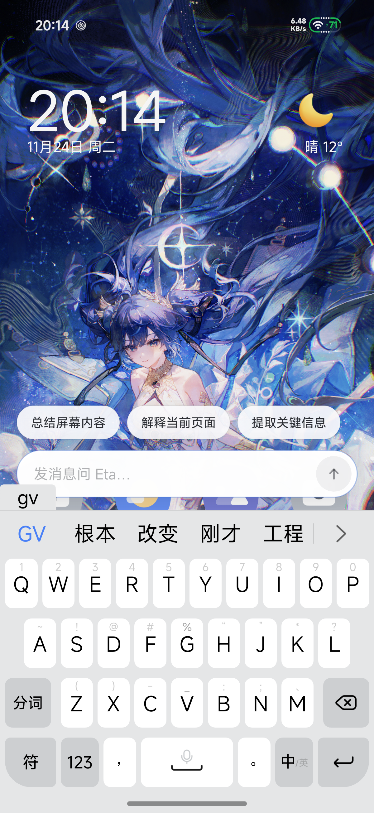

# Eta 手势（EtaGesture）

在 HyperOS 4（Android 17，含国行小米）上，为手势导航条增加：

- **双击小白条** → 唤出 **Eta 助手浮窗**（与长按电源键唤出同一个界面）

这是一个**独立**的 libxposed API 102 模块，不修改 Eta 本体；Eta 保持官方版本即可。首选路径通过系统助理会话直接唤出浮窗，不依赖 Eta 的 Activity；只有会话不可用时才回退启动 Eta 的 ASSIST 桥接 Activity。



## 功能

- 在 system_server 进程旁路观察输入事件，只在底部手势条区域识别双击，不消费触摸、不改变系统手势。
- 判定条件：单指、按下与抬起都在手势条区域、位移不超过触摸阈值、时长不超过长按阈值；第二下与第一下抬手的间隔、两次落点距离受系统双击阈值约束。
- 三键/双键导航、锁屏、开关关闭时不触发；多指、滑动、取消都会作废当前按压。
- 识别后先通过 `voiceinteraction` Binder 调 `showSessionForActiveService`，由系统直接显示 Eta 助理会话（与长按电源键一致）；失败时回退向 `io.github.mangi.eta/io.github.mangi.eta.agent.voice.EtaVoiceAssistActivity` 发送 `ACTION_ASSIST`。
- **唤醒后震动反馈**：会话成功显示或 Activity 启动成功后短震一次，可在设置页关闭。
- **隐藏桌面图标**：设置页可隐藏/恢复桌面图标，隐藏后双击与模块功能不受影响。
- 设置页开关实时生效（RemotePreferences），无需重启；日志标签 `[EtaGesture]`。

## 为什么在 system_server 里做

HyperOS 4 起手势条触摸由桌面原生手势运行时分发：`dumpsys input` 中
`[Gesture Monitor] swipe-up` 属于 `com.miui.home`，SystemUI 的 `NavigationBar0` 窗口
touchable region 为空，桌面 Java 导航视图收不到事件，模块也无法注入桌面进程。

本模块只注入 `system`（system_server），挂钩
`android.view.InputEventReceiver.dispatchInputEvent` 旁路观察 system_server 自己那两个
常驻全屏 SPY 手势监视器（`miui-gesture`、`vibrator-input`）。命中双击后直接通过
`voiceinteraction` Binder 调 `showSessionForActiveService` 显示 Eta 助理会话——与长按电源键
同一条路径，既不受 SystemUI 输入通道生命周期影响，也不会被第三方应用的后台启动 Activity
限制拦截。会话调用失败时才回退启动 Eta 的 ASSIST 桥接 Activity。

同一物理触摸会同时投递给多个 receiver，桌面的手势识别还可能只向其中一路插入 `CANCEL`。
因此每个 receiver 维护独立的状态：任一干净事件流识别出双击即可；未移动且时长在阈值内的
`CANCEL` 当作这次点击的释放，避免只有 `DOWN+CANCEL` 的流被吞掉。触发后统一做 500ms 冷却，
避免多路重复唤起。

参考项目 [Gemini-For-HyperOS4](https://github.com/fulu2778/Gemini-For-HyperOS4) 同样在
system_server 内完成电源键与系统入口接管。

## 适用范围

- HyperOS 4 / Android 17（在 Redmi K90 Pro Max，OS4.0.6.0.XPMCNXM 上实测）
- LSPosed（支持 libxposed API 102）
- 已安装 Eta，并建议将 Eta 设为默认数字助理

## 安装

1. 安装 APK：`io.github.mangi.etagesture`
2. 在 LSPosed 中启用模块 **Eta 手势**
3. 作用域只需勾选：

   | 包名 | 用途 |
   |---|---|
   | `system` | 观察 system_server 手势监视器输入并唤出 Eta 助理会话 |

4. 重启手机
5. 打开「Eta 手势」确认状态为「LSPosed 已连接」，按需开关双击、震动与桌面图标

### 隐藏桌面图标

设置页打开「隐藏桌面图标」并确认后，桌面图标立即消失（双击手势条与模块功能不受影响）。
如需再次打开设置，执行：

```text
adb shell am start -n io.github.mangi.etagesture/.SettingsActivity
```

设置页里再关闭该开关即可恢复图标；隐藏状态会保存在本机，应用升级后保持。

## 实机验证

Redmi K90 Pro Max（HyperOS 4 / OS4.0.6.0.XPMCNXM，Android 17）：

| 操作 | 结果 |
| --- | --- |
| 单击手势条 | 不触发 |
| 双击手势条 | 触发一次，Eta 助手浮窗覆盖当前应用（不切换任务） |
| 连续多次双击 | 每次双击各触发一次 |
| 会话路径日志 | `已通过助理会话唤出 Eta` |
| 震动反馈 | `dumpsys vibrator_manager` 的 Recent vibrations 中每次唤醒都出现 `android (uid=1000) | usage: TOUCH | Prebaked=CLICK` |
| 隐藏桌面图标 | 隐藏后 `cmd package query-activities` 不再解析到本应用；关闭开关后恢复 |



对应日志：`[EtaGesture] 手势条输入监听已生效`、`[EtaGesture] 手势条双击，唤出 Eta 助手浮窗`、
`[EtaGesture] 已通过助理会话唤出 Eta`。

## 排障

日志统一带 `[EtaGesture]` 前缀：

```text
adb logcat -s "[EtaGesture]"
```

正常启动应看到：

```text
模块载入 process=system
已挂钩 InputEventReceiver.dispatchInputEvent
手势条输入监听已生效          （第一次在底部横条上触摸后）
手势条双击，唤出 Eta 助手浮窗
已通过助理会话唤出 Eta        （无此条时看下一行）
已启动 Eta ASSIST 桥接 Activity
```

常见问题：

- 双击无反应：确认 LSPosed 作用域勾选 `system` 且已重启；日志没有「已挂钩」说明模块未注入 system_server。
- 有触发日志但没有界面：把 Eta 设为默认数字助理（首选会话路径），或确认 Eta 已安装且悬浮窗权限可用（回退路径）。
- 单击就触发/触发两次：本模块已按事件时间去重并做 500ms 触发冷却；若仍复现，请附日志。
- 三键导航下不生效：双击判定只在手势导航模式启用。

## 构建

要求 JDK 17 + Android SDK 36；libxposed API 102 的 jar 已放在 `app/libs/libxposed/`。

```text
./gradlew :app:testDebugUnitTest :app:assembleDebug
```

产物：`app/build/outputs/apk/debug/app-debug.apk`

## 已知限制

- 依赖 system_server 的手势监视器能收到手势条这一路输入；若某些 ROM 把它完全交给其它进程，模块不会生效（日志可区分）。
- 首选会话路径要求 Eta 是默认数字助理；否则回退启动 Eta 的 ASSIST 桥接 Activity。
- 不包含长按手势条、电源键等其它入口，避免与 Eta 自身或其它模块冲突。
- Google/厂商 ROM 升级后若方法签名变化，需要按新版本适配。
